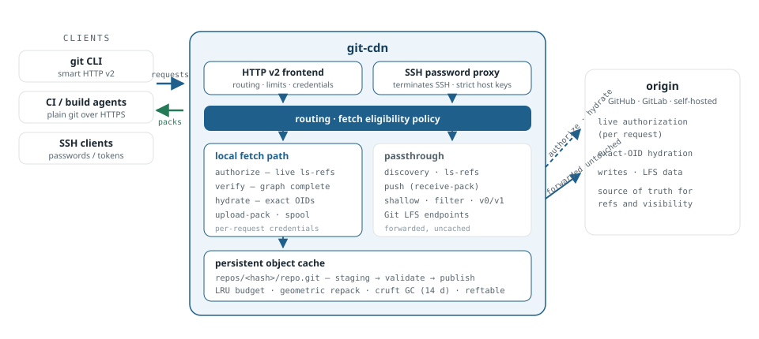

# Git CDN

**English** | [简体中文](README.zh-CN.md)

An HTTP Git caching proxy built with Go and native Git. The CDN runs on its
own domain, such as `git-cdn.example`; clients connect to it, and it
contacts the configured origin with the request's upstream credentials.
Cacheable objects are served locally — but only after the origin has
authorized the request.

- CI fleets, build agents and developer machines refetch the same
  repositories; a cache in between moves those bytes once per cache.
- Authorization stays live: every locally served fetch is authorized at the
  origin with the caller's own credentials; cached objects never authorize
  a read.
- Clients stay plain git — only the URL changes. Native Git does
  negotiation, object receipt and pack generation; Go does routing,
  authorization, cache publication and resource limits.

## Architecture

<p align="center">
  
</p>

Discovery and client ls-refs always go to the origin. A v2 fetch whose
wants are currently advertised OIDs runs locally: authorize, verify the
dependency graph, hydrate missing roots by exact OID, then serve from
local upload-pack through a bounded response spool. Everything else is
forwarded untouched.

| Request | Behavior |
| --- | --- |
| Discovery and ls-refs | Live upstream forwarding, capabilities and refs preserved |
| v2 fetch, wants are fresh tip / tag / peeled OIDs | Local: authorize → verify → hydrate → upload-pack |
| Have negotiation | Haves must be ancestors of authorized roots; otherwise upstream |
| Shallow, filter, want-ref, SHA-256, v0/v1, unknown extensions | Forward upstream |
| Push (receive-pack), Git LFS endpoints | Forward upstream, uncached |

Every fetch response carries `X-GitCDN-Cache-Status`: `HIT` (required
objects were already complete), `MISS` (hydrated this request) or `BYPASS`
(an upstream response — HIT counts objects, not reused packs). Identical
clone-shaped requests additionally reuse the generated response verbatim
(`X-GitCDN-Pack-Cache`, [docs/configuration.md](docs/configuration.md#response-pack-cache)).
Object stores are shared per upstream URL, repository path and object
format; users and rotated tokens reuse the same objects. The design
record: [docs/design.md](docs/design.md).

## Quick start

Docker (multi-site default: github + gitlab, loopback-bound):

```sh
docker compose up -d --build --wait
git clone http://127.0.0.1:8080/github/git/git.git
```

From source — needs Go 1.26+ and Git 2.45+ (reftable, protocol v2, cruft
packs) on Linux or macOS:

```sh
mkdir -p ~/.git-cdn
cp config.example.yaml ~/.git-cdn/config.yaml
go build -o bin/git-cdn ./cmd/git-cdn
./bin/git-cdn                  # listens on 127.0.0.1:8080
```

Point existing checkouts at the CDN — plain git, no plugins:

```sh
git config --global url."https://git-cdn.example/".insteadOf "https://gitlab.com/"
```

Credentials are provided for the **CDN domain** and forwarded to the
origin on every fetch ([client credentials](docs/configuration.md#client-credentials)).
The rewrite also affects push, which the CDN forwards to the upstream.

## Modes

Single site maps repository paths directly to one host; multi-site selects
the host by the first path segment:

```yaml
mode: multi
upstreams:
  gitlab: { url: https://gitlab.com }
  github: { url: https://github.com }
```

```text
https://git-cdn.example/group/repo.git                 → https://gitlab.com/group/repo.git
https://git-cdn-github.example/github/owner/repo.git   → https://github.com/owner/repo.git
```

Mode inference, credential hosts and URL normalization:
[docs/configuration.md](docs/configuration.md#modes).

## Documentation

| Doc | Contents |
|---|---|
| [docs/design.md](docs/design.md) | Architecture, authorization boundary, cache consistency, performance tradeoffs |
| [docs/configuration.md](docs/configuration.md) | Every setting and default, request limits, transport and TLS, client credentials |
| [docs/cache-policy.md](docs/cache-policy.md) | Size admission, LRU, lease protection, repack, GC retention, ref storage and migration |
| [docs/ssh.md](docs/ssh.md) | SSH password proxy and Git LFS passthrough |
| [docs/http-security.md](docs/http-security.md) | Admission limits, response spools, multi-upstream credential binding |
| [docs/docker.md](docs/docker.md) | Compose quickstart, optional SSH, state management |
| [docs/protocol-probes.md](docs/protocol-probes.md) | Local Git checks behind the design |
| [docs/testing.md](docs/testing.md) | CI matrix, live validation, measurement rules |

## Validation

```sh
go test ./...
go test -race ./...
go vet ./...
```

101 test functions across 19 files plus a fuzz target; CI runs
`go test -race` on Linux and macOS against an authenticated
`git http-backend` with standard Git clients ([docs/testing.md](docs/testing.md)).

## License

MIT. See [LICENSE](LICENSE). Third-party dependencies retain their own
licenses.
