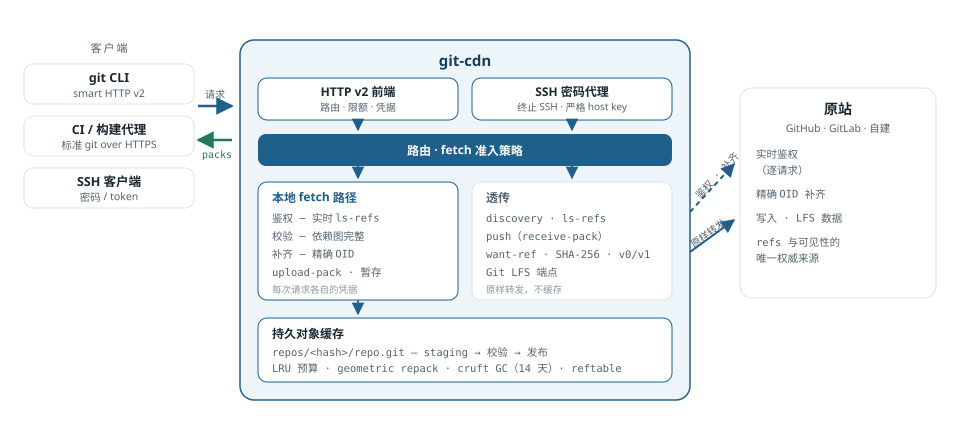

# Git CDN

[English](README.md) | 简体中文

使用 Go 和原生 Git 实现的 HTTP Git 缓存代理。CDN 使用独立域名（如
`git-cdn.example`），客户端连接 CDN，CDN 使用请求对应的上游凭据回源。可缓存
对象在本地提供服务——但前提是原站已对本次请求完成鉴权。

- CI 集群、构建代理和开发者机器反复拉取同一批仓库；中间加一层缓存后，这些
  字节只需经过原站一次。
- 鉴权保持实时：每个本地服务的 fetch 都用调用者自己的凭据在原站鉴权；缓存
  中的对象永远不构成读取授权。
- 客户端保持原生 git，变的只有 URL。原生 Git 负责协商、对象接收和 pack
  生成；Go 负责路由、鉴权、缓存发布和资源限制。

## 架构

<p align="center">
  
</p>

discovery 和客户端 ls-refs 始终发往原站。want 为当前广播 OID 的 v2 fetch
在本地执行：鉴权、校验依赖图、按精确 OID 补齐缺失 roots，再经有上限的响应
暂存从本地 upload-pack 输出。其余请求原样转发。

| 请求 | 行为 |
| --- | --- |
| discovery、ls-refs | 实时代理原站，保留协议能力和 refs |
| v2 fetch，want 是新鲜的 tip / tag / peeled OID | 本地：鉴权 → 校验 → 补齐 → upload-pack |
| have 协商 | have 必须是已授权 roots 的祖先；否则回源 |
| shallow、filter、want-ref、SHA-256、v0/v1、未知扩展 | 完整回源 |
| push（receive-pack）、Git LFS 端点 | 完整回源，不缓存 |

每个 fetch 响应都带 `X-GitCDN-Cache-Status`：`HIT`（所需对象已完整存在）、
`MISS`（本次补齐后本地生成）、`BYPASS`（原站响应——HIT 针对对象，不是复用
的 pack）。对象库按原站 URL、仓库路径和对象格式共享，不同用户和轮换后的
token 复用同一份对象。设计记录见
[docs/design.md](docs/design.md)。

## 快速开始

Docker（默认多站点：github + gitlab，仅绑定回环地址）：

```sh
docker compose up -d --build --wait
git clone http://127.0.0.1:8080/github/git/git.git
```

从源码构建——需要 Go 1.26+ 和 Git 2.45+（reftable、protocol v2、cruft
pack），Linux 或 macOS：

```sh
mkdir -p ~/.git-cdn
cp config.example.yaml ~/.git-cdn/config.yaml
go build -o bin/git-cdn ./cmd/git-cdn
./bin/git-cdn                  # 监听 127.0.0.1:8080
```

把已有检出指向 CDN——原生 git，无需插件：

```sh
git config --global url."https://git-cdn.example/".insteadOf "https://gitlab.com/"
```

凭据提供给 **CDN 的域名**，每次 fetch 由 CDN 转发给原站
（[客户端凭据](docs/configuration.md#client-credentials)）。改写同时影响
push，CDN 会把 push 透传给上游。

## 模式

单站点把仓库路径直接映射到一个固定上游；多站点用路径第一段选择上游：

```yaml
mode: multi
upstreams:
  gitlab: { url: https://gitlab.com }
  github: { url: https://github.com }
```

```text
https://git-cdn.example/group/repo.git                 → https://gitlab.com/group/repo.git
https://git-cdn-github.example/github/owner/repo.git   → https://github.com/owner/repo.git
```

模式推断、凭据域名与 URL 规范化见
[docs/configuration.md](docs/configuration.md#modes)。

## 文档

| 文档 | 内容 |
|---|---|
| [docs/design.md](docs/design.md) | 架构、鉴权边界、缓存一致性、性能权衡 |
| [docs/configuration.md](docs/configuration.md) | 全部配置项与默认值、请求限额、传输与 TLS、客户端凭据 |
| [docs/cache-policy.md](docs/cache-policy.md) | 容量准入、LRU、租约保护、repack、GC 保留、引用存储与迁移 |
| [docs/ssh.md](docs/ssh.md) | SSH 密码代理与 Git LFS 透传 |
| [docs/http-security.md](docs/http-security.md) | 准入限制、响应暂存、多上游凭据绑定 |
| [docs/docker.md](docs/docker.md) | Compose 快速启动、可选 SSH、数据管理 |
| [docs/protocol-probes.md](docs/protocol-probes.md) | 设计依据的本地 Git 验证 |
| [docs/testing.md](docs/testing.md) | CI 矩阵、真实仓库验证、测量规则 |

## 验证

```sh
go test ./...
go test -race ./...
go vet ./...
```

19 个文件中的 101 个测试函数和 1 个 fuzz 入口；CI 在 Linux 和 macOS 上用
标准 Git 客户端驱动带认证的 `git http-backend` 运行 `go test -race`
（[docs/testing.md](docs/testing.md)）。

## 许可证

MIT，见 [LICENSE](LICENSE)。第三方依赖保留各自的许可证。
