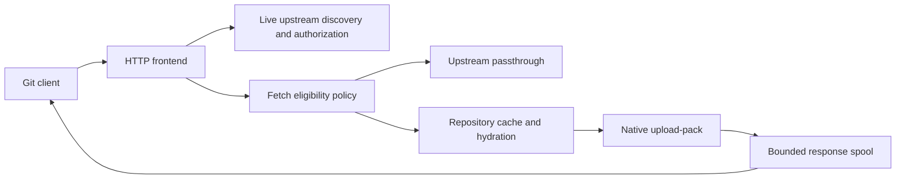

# Design

Git CDN is an HTTP reverse proxy with a local Git object cache. The upstream Git host remains authoritative for credentials, visible refs and writes. Native Git performs negotiation, object receipt and pack generation; Go controls routing, authorization, cache publication and resource limits.

## Request paths



Single-site mode uses `/owner/repository`; multi-site mode uses `/<site>/owner/repository`. The configured upstream is fixed, and `.git` is normalized before forwarding. The CDN has its own domain and credential scope. It is not a CONNECT tunnel or a byte-for-byte HTTP proxy: it filters headers, rewrites trusted redirects and generates local fetch responses.

Discovery and client ls-refs requests go upstream. Supported v2 fetches can use the cache; push, shallow/filter requests, unknown extensions, SHA-256 and v0/v1 use passthrough. See the README for the current support matrix.

## Authorization boundary

Every fetch selected for local execution performs a fresh upstream ls-refs query using that request's credentials. A previous discovery, another user's result or the presence of local objects does not authorize a read. Invalid/oversized responses and authentication failures cannot serve cached data. Concurrent probes for the same repository and credential merge into one upstream request — waiters reuse the leader's fresh result, which keeps authorization live while collapsing clone storms. A configured `auth_probe_cache_ttl` explicitly degrades this to near-live: a successful probe is reused for at most that lifetime, a revoked credential stays readable no longer than the window, and denials are never reused.

Protocol v2 permits direct OID wants beyond advertised refs. Git upload-pack can serve retained objects that no longer appear in upstream refs, so its configuration switches are not sufficient authorization. The local path accepts current advertised tip/tag/peeled OIDs; other wants are forwarded for the upstream to decide. Haves must be ancestor commits of authorized roots. Relevant tags are checked before include-tag processing.

Cache identity includes the canonical upstream URL, repository path and object format. All authorized readers of the same repository share objects and a lease; token rotation does not create a new object store. When both frontends run in single-upstream mode, the SSH frontend derives the same identity from the HTTP upstream, so both protocols share one scope; multi-site deployments and explicit `cache_identity_url` settings key SSH separately by address, username and path. Credentials are passed to native Git through request-scoped configuration in the environment, without storing them in remote URLs. Request-specific ref views keep storage refs and stale tags out of response semantics. Shared storage assumes repository-level Git read access; an alternates view is not an independent ACL for different object visibility domains.

Native Git's [protocol v2 specification](https://git-scm.com/docs/gitprotocol-v2) and [namespace security discussion](https://git-scm.com/docs/gitnamespaces) are the behavioral references. Reproducible [protocol probes](protocol-probes.md) establish the relevant primitives.

## Object storage and hydration

```text
cache/
  .lock
  repos/<repository-hash>/
    .access
    repo.git/
  tmp/
    hydrate-*/
    view-*/
    response-*
    repack-*/
```

New caches and request views are bare reftable repositories. Existing files-format caches remain supported. `refs/cache/roots/<oid>` retain verified root histories. For a local fetch:

1. Acquire the shared repository lease.
2. Traverse the wanted roots with `rev-list --objects --missing=error`; a present commit alone does not prove completeness.
3. If data is missing, initialize staging and fetch exact OIDs with the caller's identity.
4. Use existing roots and alternates for incremental negotiation only when their dependency graph is intact.
5. Validate staging, reserve capacity, publish objects and pin roots.
6. Build the current request's ref view and run upload-pack.

Fresh caches are published by renaming checked staging. Existing caches install pack data before indexes and refs. Failed staging is removed on the normal error path. Missing objects, authorization failures and transport errors remain distinct outcomes; ordinary failures do not blindly delete/reclone the whole cache.

The current model stores complete histories for requested roots. It does not import arbitrary external shallow/promisor repositories or resume incomplete packs. Filtered/shallow client requests go upstream. Server-side native lazy fetching is disabled. Adding promisor storage needs object authorization, completeness metadata, bounded fetches and safe interaction with maintenance.

Every locally served fetch carries a complete live ref snapshot from its authorization probe, and background reconciliation follows any of them: the trigger is debounced by snapshot-fingerprint drift or accumulated hydrations, it takes the repository gate only while the scope is idle, and a queued request preempts it. Complete cached tips and tags are named under `refs/cache/upstream/`; roots no longer named by the snapshot retire into the retention grace period — which also bounds root accumulation for fleets that keep fetching unadvertised SHAs — and HEAD follows the upstream. Uncached refs remain absent without fetching their objects. Queued requests from earlier probes cannot overwrite a later synchronized snapshot. Storage refs never authorize reads or replace the request's upstream view.

Idle repositories reaching `repack_pack_threshold` run `git repack --geometric=2 -d` with a repository lease, process limit and deadline. A private repository hardlinks immutable objects and copies mutable metadata. Extra capacity is reserved and new bytes are sampled every 200 ms. Its complete pack set is validated before installing new packs and removing superseded packs. Timeout and budget failure remove temporary output while retaining published objects. GC runs independently of pack count every 24 hours on idle repositories. It expires objects through cruft repack and loose pruning with a minimum 14-day cutoff, preserves cruft `.mtimes` during geometric maintenance, and retains removed-root closures for at least 14 days from unpinning using `refs/cache/retained/` and `.gc-retained`. Expired grace refs are removed in staging, and retained packs plus age metadata are published before old pins and objects are removed. `.gc-last` persists successful runs. These internal refs do not authorize reads; ordinary whole-repository LRU remains separate from GC retention.

Startup merges legacy credential scopes into `repos/<repository-hash>/repo.git` under the directory lock. Root journals permit interrupted migration to resume; old scopes are removed after merged dependencies validate.

## Capacity and concurrency

Persistent repository scopes use LRU with capacity reservations and restartable access timestamps. Active and queued leases protect their objects. Oversized requests and fully pinned capacity use upstream fallback. Temporary files have separate operating constraints; the admission limit is not a filesystem quota. See [Cache policy](cache-policy.md).

The per-scope gate is a reader/writer lock. Hydration, ref reconciliation and maintenance hold it exclusively; validation, ref views and local pack generation run under shared reader leases, so warm incremental fetches of one repository proceed in parallel while writers wait, and waiting writers in turn block fresh readers to prevent starvation. Validation costs one batched process per stage: client haves and include-tag targets are decided by a single rev-list over signed revisions instead of per-pair probes, and on large scopes the completeness check first consults the pinned-root index — every ref under `refs/cache/` names a verified-complete closure, so a want inside those closures needs no object-graph walk. The index is a hint: an interrupted publish or an externally deleted pack defeats it, and the failed shared generation falls through to the exclusive path's authoritative walk, which rehydrates within the same request. Small scopes keep the direct walk, which is cheaper there than the index's two processes. Response-pack hits bypass the gate entirely: they pin the scope against eviction, stream the stored file and release the pin when the transfer ends. Storage-ref reconciliation for shared responses happens on a background writer instead of the response path — debounced, idle-only and preemptible by queued requests; store shutdown joins in-flight reconciliation, so no git child outlives the cache directory. A queued request cancels long maintenance on its scope; maintenance retries on its next pass. A global limit controls all native Git processes, including metadata commands.

Capacity accounting keeps filesystem work off the global critical section: writer releases rescan their scope's size while still holding its exclusive gate, before taking the store mutex to apply the delta, and recency stamps persist outside the mutex at a throttled interval (shutdown flushes suppressed stamps so a clean restart keeps last-touch ordering). Eviction deletion still runs under the store mutex; moving it out remains future work.

## Response delivery and performance

Local upload-pack writes a bounded temporary response before the server commits headers. This preserves the ability to forward one complete upstream response after local generation failure. Generation and spool writes overlap, but client transfer starts only after success. Cold requests additionally complete upstream fetch/index/check/publication before local packing.

This design increases time to first byte and file I/O. Cacheable requests — wants, `done`, no client haves, including shallow and filtered shapes such as `git fetch --depth=1` fleets — no longer regenerate on every object-cache HIT: their completed responses are reused verbatim from a per-repository pack cache keyed by the exact request bytes and the live ref snapshot's parse-time fingerprint, skipping hydration, ref views and upload-pack while the per-request authorization probe still runs (see [Configuration](configuration.md#response-pack-cache)). Requests carrying client haves still generate per request; a streaming mode can reduce their latency but must define errors after response commitment, when complete fallback is no longer possible.

Concurrent identical cacheable requests share work at two levels. On a warm scope under shared reader leases, one reader leads the generation while the others wait on an in-flight flight and stream the stored entry, so a batch costs one upload-pack. Warm hits additionally share one read of the stored entry through a bounded response broadcast: the first reader's pump distributes fixed-size blocks to every subscriber that attached from the stream's start, a late subscriber serves the prefix it missed from its own file reads and continues with the broadcast, and a subscriber whose bounded queue fills detaches and finishes from its own reads at its own offset. Broadcast memory is hard-bounded by a fixed block-slot semaphore whose buffers come from a pooled free list — the collector drains idle buffers under memory pressure instead of counting them against a soft limit — server shutdown detaches rather than truncates in-flight transfers, and the per-request authorization probe is unchanged.

`memory_limit_bytes` configures a Go soft memory limit for the service process: the collector works harder as the heap approaches the limit instead of growing toward an out-of-memory kill. It bounds this process only; child Git processes have their own limits, and the on-disk budgets (cache, temporary and response-pack) are unaffected.

Measure request upload, authorization, lease queueing, dependency checks, hydration, publication, pack generation, spool I/O and client transfer separately. Correctness checks and one-off elapsed times are not throughput or latency baselines. The [testing guide](testing.md) describes workload selection and reproducibility.

## Deployment

A production data plane benefits from stable placement, enough local SSD space and controlled cache lifecycle. Each instance currently owns an independent cache; application cache coordination and cross-node routing are external concerns. The upstream remains the recoverable source of all objects.

The [SSH password frontend](ssh.md) terminates SSH and submits the same password/token to a fixed origin. It accepts Git exec commands and GIT_PROTOCOL, validates current refs before supported complete v2 fetches, and receives missing objects over SSH with native index-pack. Other sessions stream upstream; negotiation-only fetches commit the remaining session to passthrough. Origin host keys are verified and reusable passwords remain connection-scoped. Key-only authentication still needs delegation or a signing design; transport acceptance is not repository authorization.

## Code map

| Package | Responsibility |
| --- | --- |
| `internal/config` | YAML, site modes, defaults and validation |
| `internal/protocol` | pkt-line parsing, v2 classification and ref snapshots |
| `internal/nativegit` | Controlled Git execution and process cancellation |
| `internal/cache` | Leases, object receipt/publication, ref views and LRU |
| `internal/server` | Routing, upstream probes, local response generation and passthrough |
| `cmd/git-cdn` | Listener, TLS and lifecycle |
