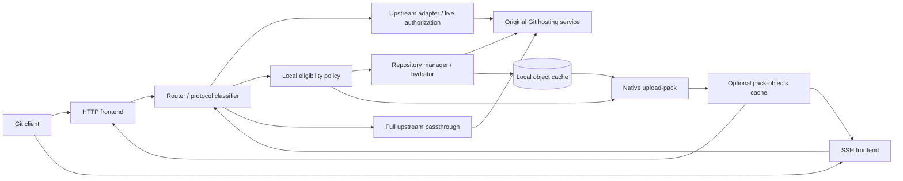
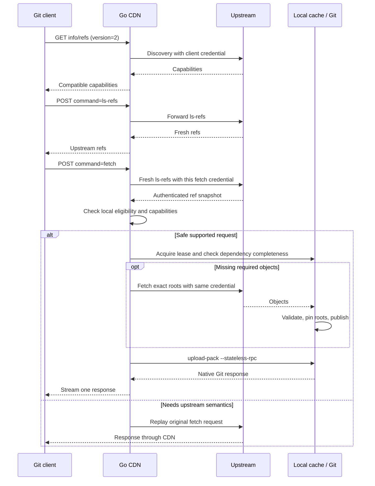

# Go Git CDN 设计方案

日期：2026-11-18。状态：HTTP v2 首版已实现，真实上游集成待验证；本文仍保留后续阶段的目标设计。

实际首版的启动、配置、支持矩阵及限制见 [README](../README.md)。实现默认按凭据隔离缓存，使用单进程目录锁及每仓库操作锁；依赖完整性实时遍历，尚未引入 generation/manifest 快速证明或自动 GC。为保证失败后可完整回源，本地响应先落磁盘再发送，尚未实现流式 pack 生产者缓存。SSH 为后续阶段。

默认配置入口为 `~/.git-cdn/config.yaml`，可通过 `-config` 覆盖；默认缓存为 `~/.git-cdn/caches`，可通过 YAML 的 `cache_dir` 调整。两个路径均支持 `~/` 展开，显式相对路径仍基于启动工作目录解析。HTTP 已实现两种部署模式：`mode: single` + `upstream` 直接代理 `/group/repo[.git]`；`mode: multi` + `upstreams` 按 `/gitlab/group/repo[.git]` 的第一段选择原站。下文带 `/gitlab/` 的示例表示多站点模式，单站点使用无该前缀的仓库路径。

## 1. 推荐方案与可行性结论

采用 **Go 控制服务 + 原生 Git 数据处理**。Go 实现接入、上游鉴权、协议分流、对象补齐、并发控制及缓存；`git upload-pack` 负责协商和打包，`git fetch` / `index-pack` 负责对象接收。优先实现 HTTP smart protocol v2，再实现 SSH。

**既定部署约束：Git CDN 使用独立域名，与 `gitlab.com` 不同。** 下文以 `git-cdn.example` 为占位示例；HTTPS 和 SSH 均由 CDN 自己的入口接收，再连接配置中的原始服务。CDN 的证书、SSH host identity、客户端凭据作用域与原站分别管理。

可以实现以下行为：客户端访问 CDN，refs 和权限以原始服务为准；满足本地处理条件的 clone/fetch 从本地打包；缺少数据时按需获取；超出本地能力的请求完整回源。这里的“透明”指标准 Git 客户端可用且操作结果保持兼容，不要求生成相同的 pack 字节，也不意味着无需配置入口或凭据。

有三个必须明确的限制：

1. **仅靠 `ls-refs` 不能确认任意 OID 都可本地返回。** 它提供当前凭据可见的 refs，而 v2 fetch 允许客户端直接请求 OID。对于缓存中的历史、删除、隐藏或其他身份曾拉取的对象，不能把鉴权成功当作授权证明。首版只把新鲜 refs 快照能证明的请求放入本地路径，其余回源。
2. **客户端连接独立 CDN 入口，TLS / SSH 在 CDN 终止。** CDN 另外建立到原站的 HTTPS / SSH 连接，才能处理 Git 明文、鉴权和本地打包。
3. **SSH 公钥认证不能自动转接到上游。** CDN 验证了客户端持有私钥，不代表 CDN 持有可向原始服务登录的签名能力。需要平台授权/凭据委托接口、已建立的用户凭据映射，或客户端 agent forwarding。

这里的部署方案是独立入口的 Git 协议代理。客户端通过 CDN URL 或 URL 改写接入，授权和 refs 仍由原站决定；使用明确的凭据配置和请求回源保持兼容。

## 2. 范围和不变量

首要目标是 clone/fetch 加速，尤其是同仓库重复 CI 克隆。push 通过原始服务处理，CDN 不修改本地 refs 来模拟 push。LFS、submodule 和 archive 需要各自的路由与授权，不能当作 Git pack 自动覆盖。

运行环境假设为 Linux + 本地 SSD/NVMe；macOS 工作区用于设计和原语验证。部署时固定并验证 Git 版本，支持 SHA-1 / SHA-256 的程度按阶段开放。

必须始终成立：

- 每次准备返回 Git 对象的 fetch 请求都做实时上游鉴权，pack 命中也一样；不能依赖之前一次 GET、连接建立或其他用户的结果。
- 未通过鉴权前不返回缓存数据。401、403、404 及超时按平台语义处理；鉴权服务故障时不能使用旧的成功结果继续提供数据。
- 客户端可见 refs 来自当前请求的上游视图；本地缓存 refs 只用于管理存储和 GC，不作为权限或新鲜度依据。
- 缓存身份至少包含上游实例、规范仓库身份及对象格式，不能只有路径、仓库 basename 或请求哈希。
- 只有满足当前请求的完整性条件时才能本地服务。`cat-file` 发现 want 存在，仅是第一步。
- 响应开始后不能改为另一个完整响应。Git 协议节、HTTP body、SSH channel 数据都不能通过“失败后重试并拼接”修复。
- 已鉴权和已完成是不同状态。缓存完成条目必须在接收、校验和发布成功后才可见，失败及取消不能发布半成品。

## 3. 用 ls-refs 鉴权的正确边界

### 3.1 实时探测

HTTP v2 的正常过程是：GET `info/refs?service=git-upload-pack` 返回版本及 capabilities；随后 POST `git-upload-pack` 执行 `command=ls-refs`；再执行一个或多个 `command=fetch`。v0/v1 的初始 info/refs 才直接包含 refs，不能混用两种模型。

CDN 对每个要本地执行的 v2 fetch，自行使用**该请求的凭据**发起 ls-refs 探测，收集 refs、HEAD/symref、peeled tags 和对象格式。不能要求客户端必须先发 ls-refs；partial clone 的后续对象请求可能直接发 fetch。v0/v1 使用实时 info/refs，或在确认上游支持时额外用 v2 探测。

一个最小 v2 探测负载如下，各行以 pkt-line 编码，`0001` 是 delimiter，`0000` 是 flush：

```text
command=ls-refs\n
0001
symrefs\n
peel\n
0000
```

功能参数必须以实际 capabilities 为准。成功条件是：HTTP 状态符合 smart Git 语义，Content-Type 和编码可解析，pkt-line 完整结束，返回值不是登录页或 `ERR`。空仓库可以返回有效的空 refs 集合；这不是鉴权失败。上游将请求降级到 v0/v1 时应识别实际响应，不能仍按 v2 解析。

传递上游需要的 Authorization、经适配器允许的认证 Cookie/扩展头、协议头。HTTP client 不使用跨用户 cookie jar；请求身份不绑定在可被其他用户复用的 HTTP 连接上。遇到需要连接级认证的上游，单独适配或回源。

首版不缓存正向鉴权结果。可以复用连接，并合并同一时刻、同一凭据和仓库的探测；这不能成为跨时间的授权 TTL。SSH 会话可记录初始 capabilities，但每次本地 fetch 仍刷新授权，并限制长时间协商与慢速输入，避免无限拉长检查到使用之间的窗口。

### 3.2 本地处理范围

首版采用保守策略：want 必须是本次快照中出现的 tip、tag OID 或有效 peeled OID；本地必须能提供其完整依赖。历史 commit、单独 blob/tree、已删除 ref 的旧 OID、无法解析的 want-ref 等请求完整回源。回源是兼容路径，不应直接拒绝合法的 Git 请求。

进一步开放“可达对象”时，需要用新鲜 roots 验证 OID 可达性，使用 commit-graph/祖先检查或对象可达性索引；索引依赖 roots 和存储 generation，只用于证明内容关系，不能代替实时鉴权。没有足够证据或超过计算预算时回源。

还需处理 have、shallow、deepen-not、want-ref、include-tag 等能影响对象选择的字段。首版只本地执行已实现并校验语义的字段组合。例如普通 fetch 的已知 have commit，可以验证其位于已授权 wanted roots 的历史中；无法确认、来自 force-push 前旧历史的 have，走回源。不要让未经校验的字段把缓存中的另一段历史变成 delta base 或附加 tag。

`ref-prefix` 是优化提示，不是 ACL。服务端可以返回比前缀更多的 refs；保留 ref 名称的大小写及原始语义，检查实际返回结果。为了控制海量 refs 的开销，可从 HEAD/heads/tags 和明确需要的 MR 前缀开始；未覆盖的请求回源。后续用本地 OID→ref 候选索引指导上游查询，再以新鲜响应校验，不能用旧索引直接授权。

### 3.3 仓库权限和 ref 权限不能混为一谈

对于已确认采用仓库级读权限的上游，同一规范仓库的对象可以在不同身份之间共享存储，但每次请求仍须实时鉴权和校验其本地处理范围。上游“仓库可读”不自动意味着“缓存中所有已删除对象都应该继续可读”。

对于不同身份具有真正不同对象可见范围的上游，应按权限域隔离对象库存储，或先将这些仓库全部回源。**GIT_NAMESPACE、hideRefs 或请求专用 refs 视图不是共享对象库上的强读隔离。** Git 官方文档明确记录了 have/delta 等数据泄露路径。权限域未知时先回源，不能默认安全。

请求专用 refs 视图仍有价值：隔离当前 HEAD、tag、want-ref、deepen-not 的解释，避免过期本地 refs 污染正常结果。它只解决视图和一致性，不独立承担安全隔离。若上游提供针对 action/repo/OID 的权威授权接口，可作为增强适配器；普通公共 Git 协议没有统一的“检查任意 OID 是否可读但不传对象”的接口。

## 4. Go 服务架构



建议模块：

| 模块 | 职责 |
| --- | --- |
| `internal/frontend/http` | smart HTTP 路由、响应边界、push/其他端点透传 |
| `internal/frontend/ssh` | SSH handshake/channel、exec/env、身份绑定、退出码 |
| `internal/protocol` | 有界 pkt-line 解码、v0/v1/v2 分类，保留原始可重放输入 |
| `internal/upstream` | 指定 host/repo 解析、实时 refs/鉴权、HTTP/SSH 传输适配 |
| `internal/policy` | Local / Passthrough 决策、OID/refs/能力组合校验 |
| `internal/repository` | 对象库、完整性 manifest、generation、写入/GC/读取租约 |
| `internal/hydrate` | 精确 roots 获取、批量 miss 合并、预算和失败分类 |
| `internal/nativegit` | 固定 Git 命令构造、stdin/stdout/stderr、进程组生命周期 |
| `internal/packcache` | 可选 pack-objects 输出缓存及生产者/消费者管理 |
| `internal/observe` | 授权耗时、命中、回源原因、Git Trace2 和资源指标 |

核心接口可以围绕请求流和不变量定义，以下为示意，并非已实现 API：

```go
type Upstream interface {
    Discover(ctx context.Context, repo RepoID, cred Credential, q RefQuery) (RefSnapshot, error)
    FetchRoots(ctx context.Context, repo RepoID, cred Credential, roots []OID, dst StagingRepo) error
    Proxy(ctx context.Context, req ReplayableRequest, stream ResponseStream) error
}

type RepositoryManager interface {
    Acquire(ctx context.Context, repo RepoID, scope CacheScope) (ReadLease, error)
    Ensure(ctx context.Context, lease ReadLease, cred Credential, need ObjectNeed) (ReadLease, error)
}

type Policy interface {
    Decide(req FetchRequest, fresh RefSnapshot, cache CacheManifest) Decision
}
```

Credential 是请求生命周期内的受控引用，不可直接 JSON 序列化。RefSnapshot 包含 repo 身份、采集时间、对象格式、refs、capabilities 及可见范围说明。ReadLease 固定 generation 并阻止底层对象被并发 GC/删除；Ensure 需要切换 generation 时返回新的租约。

本地执行前构造受控 serving view：请求专用 bare 目录通过 alternates 引用持有租约的对象库，refs 仅包含本次快照中与请求有关且对象已就绪的分支/标签，HEAD 使用本次 symref。存储层 `refs/cache/*` 和过期标签不进入此视图；include-tag 只基于当前允许的标签，缺少其对象时先补齐或回源。用服务端固定配置运行 upload-pack，默认 `GIT_NO_LAZY_FETCH=1`，禁止隐式使用机器全局配置。这与 Go 层字段校验和权限域隔离一起使用，不能把 alternates 视图本身当作 ACL。

选择原生 Git，是因为 upload-pack 不只是把若干 OID 压成 pack：还包含多轮 have 协商、thin pack、shallow 边界、partial filter、tag 和 sideband 等。纯 Go 数据面可以单独研究，但不建议在首版同时重写这些语义。Go 服务不依赖 Gitaly 部署或它的内部 RPC。

## 5. HTTP 接入与请求处理

### 5.1 独立域名的反向代理入口

入口和上游明确分开：

```text
Git client
  -- HTTPS to git-cdn.example --> CDN TLS termination / Go Git handler
  -- upstream connection from CDN --> https://gitlab.com
```

CDN 使用 `git-cdn.example` 的有效证书；回源验证 `gitlab.com` 的证书，并使用原站的 Host/SNI。TLS 的两段连接都按各自域名认证。请求路径 `/gitlab/group/repo.git` 由固定 upstream `gitlab` 映射到原站 `/group/repo.git`。CDN 主机名不参与原站 repository identity 的计算。

单站点由 YAML 的 `upstream.url` 固定原站，客户端访问 `/group/repo.git`；多站点由 `upstreams.<id>.url` 定义原站，客户端访问 `/<id>/group/repo.git`。使用明确模式选择路由，单站点不会把仓库 namespace 当作站点 ID，多站点不会自动猜测未知 ID。

带 `.git` 与不带 `.git` 的 URL 都是支持的输入格式：`/gitlab/group/repo` 和 `/gitlab/group/repo.git` 统一映射到原站 `/group/repo.git`，并采用相同的规范缓存身份。discovery、upload-pack、receive-pack 和标准 info/lfs 路由在回源前完成后缀规范化，避免 POST 依赖原站重定向。

独立入口示例：

```sh
git config --global url."https://git-cdn.example/gitlab/".insteadOf "https://gitlab.com/"
```

`/gitlab/` 映射到配置中的固定 upstream ID。不要从任意客户端 URL 决定回源目标。insteadOf 也可能影响 push，所以使用这个全局规则时，CDN 把 receive-pack 的 discovery 和请求完整透传。

也可以逐仓库配置独立 fetch URL 和直达原站的 push URL：

```sh
git remote set-url origin https://git-cdn.example/gitlab/group/repo.git
git remote set-url --push origin https://gitlab.com/group/repo.git
```

这组逐 remote 示例适用于未启用上述全局 insteadOf 的情况；如果同时启用全局改写，原站 push URL 仍可能被改写到 CDN。客户端配置必须明确选择一种接入方式。

**凭据不会随 URL 改写自动迁移。** Git credential helper 通常按实际连接的 protocol/host/path 查询，因此用户需要为 CDN 入口配置适用于目标上游的凭据，或使用明确支持该映射的 helper。CDN 可以接收原站 PAT/Basic/Bearer 等凭据并仅转交配置中对应的上游，无需额外建立 CDN 用户账号；具体方式取决于原站支持的 Git 认证机制。若以后采用 CDN 专用 token，则需要另行实现其到上游用户作用域凭据的委托，不能直接拿 CDN token 调用原站。

多上游共用一个 CDN 域名时，认证作用域包含 upstream ID 和 repo 路径；客户端 helper 可使用 `credential.useHttpPath` 及路径映射，避免同 host 下的凭据误用。原站登录 Cookie 的域限制、SSO 页面跳转也不会自动适配独立 CDN 域名。对 Git 认证保留必要 challenge；对受信的仓库规范化重定向，显式改写回 CDN 路由，避免请求意外离开 CDN；登录页不作为成功鉴权结果。

### 5.2 每次 fetch 的主流程



每一轮 fetch 都独立鉴权及决策。不能把前一轮 CDN 的 ACK 写成下一轮隐含状态，也不能擅自把缺失 have 视为缺失 want。正常 v2 客户端会携带下一轮所需状态；仍由原生 Git 实际执行协商。

路由规则：GET discovery 与 POST ls-refs 以实时上游结果为准；支持的 fetch 才进入本地；未知 v2 命令/扩展、尚未开放的对象格式、复杂 filter/浅克隆组合、archive、LFS 等透传；push 从 discovery 到 receive-pack 都由原始服务处理，不重试不可重放的流。

### 5.3 能力和响应边界

advertisement 是客户端的能力契约。两个可行策略是：公布本地和上游都支持的交集；或保留上游能力，同时承诺用回源实现所有本地不支持的组合。**首版采用后者**，以保留上游能力为原则；本地请求必须逐项通过本地支持矩阵。不能按 Git agent 字符串猜能力，也不能上游 advertise 了 ref-in-want 后让本地静默忽略 want-ref。

解析器限制单个 pkt-line 长度、请求解压后大小、want/have 数、refs 响应大小和输入时间。保留可重放的原始 body：小请求内存保存，大请求在有配额的临时文件中保存。对合法但未支持的语义回源；对不满足 framing 或资源上限的输入返回协议/请求错误，避免无限缓存或解析。参数值不整体转小写，不把可重复字段压成 map 后覆盖。

对 gzip 等编码，决定保持原始压缩字节透传，或显式解压、处理后正确更新 headers。Go Transport 的自动解压、Content-Length、Content-Encoding、hop-by-hop headers 必须一起处理。鉴权不能仅看 200。401 challenge 等必要 headers 要保留，重定向只按受信上游策略处理，不能携带 Authorization 跳到任意 host。

**所有可能完整回源的决策都在响应提交前完成。** 选择本地后持有可靠对象租约；输出前可用有界缓冲拦截早期 ERR，但缓冲前几 KB 无法证明后面的 pack 一定成功。流开始后遇到磁盘故障，只能按当前协议状态报告错误或终止连接，让客户端重试；不能追加另一个 pack。

HTTP 的 0000/0001/0002 framing 根据实际 transport 契约处理。native stateless upload-pack 的输出和 HTTP remote helper 所需的 response-end 不能凭经验多加/少加。需用真实客户端 E2E 检查，不把本地直接调用实验当作 HTTP 服务验收。

## 6. 本地对象库和懒加载

### 6.1 缓存布局

```text
cache/
  repos/<upstream-id>/<repo-key>/<scope>/
    metadata.json                 # identity、object format、current generation
    generations/<g>/repo.git/     # 服务端管理的 bare repository
    manifests/<g>.json            # roots 完整性及存储状态
    staging/<operation-id>/       # 未发布的接收对象
    locks/                        # hydration / publication / maintenance
  packs/<repo-key>/<scope>/<key>/
    output.pack
    manifest.json                 # completed、校验信息、profile
```

repo-key 用规范身份计算，保持原始路径大小写，做确定的 `.git` 后缀规范化。平台能提供稳定 repository ID 时优先采用；否则路径重用/重定向可能需要清空并建立新的身份 generation。host、port、实例隔离和对象格式都必须进入身份判断。不把用户凭据写入 remote URL 或 metadata。

### 6.2 首版的“懒加载”是按请求 roots 补齐依赖

先不把共享缓存做成浅仓库或任意缺洞的 partial repository。缓存按需获得客户端请求的 tip 及其完整依赖，不要求持有全仓库全部 refs。这仍是惰性更新：请求新 branch/tip 前不拉取它，不扫描并 fetch 全部 MR 和标签。

miss 时，在同一 repo/scope 的 hydration 调度器中合并所需 roots，重新检查其他操作是否已经补齐，再使用当前请求的上游身份获取精确 OID。示意命令：

```sh
git -C <staging-bare> -c protocol.version=2 fetch \
  --no-tags --no-recurse-submodules --no-auto-maintenance --no-write-fetch-head \
  <fixed-origin-url> \
  <oid>:refs/cache/roots/<oid>
```

认证通过受控 credential provider / 请求专用配置注入，不出现在命令行和持久 remote URL。Basic 可以用请求专用 credential helper；Bearer 或特殊头可用精确 URL 作用域的受保护配置/继承 FD，或 HTTP 传输适配器。子进程不使用机器默认 credential helper，不允许交互式登录。配置和凭据引用在操作结束后释放。

直接按 OID 获取能避免 fetch ref 名称时分支变化，把 A 的授权错误地用于 B。若上游不接受此 OID、A 在 ls-refs 后被 force-push/GC，或者补齐超过预算，重新探测一次或完整回源原始请求；不能把 want 偷换成最新 tip。按 ref 获取只能在结果再次匹配已授权 OID 后使用。

接收后验证对象和依赖闭包，更新 GC root，再发布完成状态。`rev-list --objects --missing=print` 可以检查可遍历的缺失依赖，但不是所有损坏的唯一检测方法；还要处理 pack/index 校验、解析错误和必要的 connectivity 检查。实验已证明只查 wanted commit 不足够。

完整性 manifest 将“已验证完整 root + generation + 非 shallow 状态”作为快速证明，避免每次 clone 都枚举数百万对象。每次读取前检查租约及 manifest；后台抽样/fsck 负责检测磁盘损坏。健康完整仓库中未知 have 通常只是协商分歧，不应触发全仓库更新。

### 6.3 发布、并发与 GC

原生 Git fetch 会逐步写 pack/refs，不能声称整个仓库目录天然具备请求级事务。首版使用每仓库写锁及维护锁，staging 接收后受控发布；读取拿 lease。已有稳定对象上的 pack 读取可并行，涉及根删除、repack/prune、仓库换代的维护必须等待相关读取结束。

后续可做不可变 generation：新 generation 引用旧 generation 的稳定对象，发布指针原子切换，旧 generation 在所有 reader 和依赖释放后回收。alternates 的依赖链需要引用计数和周期性合并；不能删除仍被新 generation 引用的旧目录。多进程用文件锁或共享协调层，单进程 singleflight 不足以覆盖所有 writer。

hydration singleflight 的键至少含 repo/scope、所需 roots 及必要的身份/策略维度。每个等待者独立鉴权；调用者 A 的 403 不能成为 B 的仓库级失败缓存。同一仓库权限域已被适配器明确确认时才放宽身份合并。

缓存 roots 或 keep 策略防止请求所需对象被 GC。后台逐出按容量/访问/仓库配额执行，不能边上传边 `rm -rf` 当前仓库。区分对象缺失、无权、upstream rate limit、超时、协议不支持、磁盘满和已验证损坏；普通 miss 不进入“删除仓库重克隆”。

### 6.4 冷启动、partial clone 和逐对象懒取

按 root 完整补齐有成本：即使客户端 `--depth=1` 或 `--filter=blob:none`，补齐完整历史也可能很大。不能把这个成本隐去。首版为 miss 设置时间、对象量/字节量和并发预算；不适合前台补齐的大仓库冷请求直接回源，后续根据热点选择预热。取消超预算的 fetch 时先终止整个进程组、清理 staging，再启动一次原始请求回源。

完整 cache 可以服务浅客户端，本地实验已验证；这不要求共享 cache 存储 shallow 边界。浅 cache 的 shallow 文件会改变全仓库遍历语义，不适合直接当不同 depth 用户的共享完整缓存。

逐对象按需读取可以在第二阶段采用 promisor repository。当前 Git 的 upload-pack 默认拒绝自动 lazy fetch，`GIT_NO_LAZY_FETCH=0` 才允许覆盖。这不是只改一个环境变量即可上线的功能：需要受信配置、逐请求身份、miss 批量化、fetch 次数/数据量限额、promisor 完整性模型及与 pack 生成/GC 的并发控制。不能用一个全局高权限 token 为所有用户的缺洞对象兜底。

partial clone 的后续请求常直接 want blob/tree，没有当前 ref tip。首版把这类请求透传；后续只有在可达性或权威对象授权证明充分时才本地服务。过滤收到的 pack 不能登记为 unfiltered 完整 root。

“回源响应顺便灌入对象库”也要限定条件。客户端 have 可能产生 thin pack，而 CDN 未必拥有这些 delta bases；shallow/filtered pack 也不是完整仓库闭包。仅在完整、无过滤且依赖能验证的响应中考虑接收并 `index-pack`；其余不发布完整缓存状态。失败接收不影响正在转发的原始响应。

## 7. pack 缓存与资源成本

第一阶段只做对象缓存；上线后根据重复 CI clone 的 CPU 成本再开启 pack 缓存。普通 Git fetch 的不同 have 集合命中率低，全量缓存所有响应会增加磁盘写压力。

更推荐借鉴 Gitaly 的 **pack-objects hook 缓存**，而非缓存整个 upload-pack 的 ACK、shallow-info 和 sideband 响应。协商仍由 Git 正常执行，hook 仅复用相同 pack-objects 输入的输出。

缓存键至少包含：规范 repo/scope、对象格式、Git/pack profile、pack-objects argv 及完整 stdin；对于 include-tag、want-ref、shallow 等受视图影响的情况，还需纳入相关 refs/视图语义。首版可把视图 digest 放入键，接受它对命中率的影响；后续经过验证再精简。不能只 hash 参数名，也不能让不同仓库共享一个全局请求 hash。

命中只复用内容，鉴权和当前请求的本地适用性校验仍必须执行。条目由临时文件、成功状态和校验 manifest 发布；文件以 `0000` 结尾不能证明 pack 完整。raw pack 尾部校验、thin bases 及生产者退出状态各有不同职责。

生产者可边写边服务多个消费者，需有有界内存和明确磁盘配额。一个消费者断开不应杀掉其他消费者共享的生产者；所有消费者离开、达到操作 deadline 或服务退出时则应结束任务。不能只 `context.WithoutCancel` 后无限运行。慢消费者不能无限钉住内存、文件或 Git 进程。

先用进程内协调及本地文件，避免首版将大 pack 和分布式生产者/消费者同步放进 Redis/对象存储。水平扩展按 repo-key 一致性路由，多节点分别缓存；节点失效时可换节点或回源，CDN 的缓存不成为仓库唯一副本。

## 8. SSH 可行性与实现方式

### 8.1 独立 SSH 主机与上游身份委托

客户端连接 `ssh://git@git-cdn.example/gitlab/group/repo.git`，验证 CDN 自己的 host key/证书。`gitlab` 前缀选择固定上游，CDN 将 exec 中的路径映射为原站仓库路径。原站 SSH host/port 单独配置并校验 host key；实际地址需在平台接入阶段确认。

SSH 用户证明持有私钥时，签名包含该 SSH 会话标识和认证数据。CDN 连接上游会产生另一个会话，因此不能重放客户端发给 CDN 的签名；CDN 手上只有公钥时也不能替用户生成新签名。上游接受某公钥的探测结果不能替代仓库授权。

| 路线 | 本地打包 | 上游实时鉴权 | 适用条件 |
| --- | --- | --- | --- |
| 独立 CDN 通过平台接口集成身份 | 可行，有接口时优先 | 验证 key→平台身份，获得用户作用域委托能力，再执行实时 refs/授权查询 | 平台提供可信 key registry、repo/action 授权和回源身份机制；CDN 仍使用独立域名 |
| 用户 key→用户 token 的已配置映射 | 可行 | 用映射身份的 HTTPS ls-refs；push/回源也需对应 action 凭据 | 用户/平台明确完成身份绑定，权限一致且凭据有生命周期 |
| SSH agent forwarding | 可行，客户端需配置 | CDN 用被转发 agent 中与登录身份绑定的 signer 连接原站，执行 upload-pack/ls-refs | 客户端启用转发、CDN 被信任、算法和 agent 限制兼容 |
| SSH ProxyJump / ProxyCommand TCP 转发 | 无法本地打包 | 完全由原站处理 | 可以保持端到端 SSH 认证，但 CDN 只有密文 |
| CDN 接受公钥，然后拿该公钥直接连原站 | 不可行 | 无私钥/agent/委托签名能力 | 不能靠 sshd 代码解决密码学边界 |

对于 `gitlab.com`，应先确认平台实际支持哪种 key lookup / 用户委托接口。GitLab Shell 的内部 `/allowed` 只是有平台信任关系时的参考，不能假定它对第三方 CDN 开放。返回 allowed 也不等于已经获得可用于公共 SSH/HTTP 回源的用户凭据；这两项能力要分别验证。

agent 方案只用与已验证登录 key 匹配的 signer，不能任意挑选 agent 中另一把高权限 key。遵守客户端 destination constraints；不兼容时应明确失败或使用已配置的其他委托路径。agent forwarding 给 CDN 调用签名器的能力，不能默认强制开启。没有合法委托能力时只能走客户端明确配置的直连/隧道路径，不能伪装成已有鉴权的本地加速。

### 8.2 Go SSH 入口

实现可使用维护中的 `golang.org/x/crypto/ssh`，或先以 OpenSSH forced command + Go Git handler 验证数据面，再引入内置 sshd。标准 Git SSH 客户端发 `exec "git-upload-pack 'group/repo.git'"`，并可通过 env request 传 `GIT_PROTOCOL=version=2`。

必须区分三个阶段：key 校验、完成 SSH handshake 的持钥证明、exec 中的 repo/action 授权。库的 PublicKeyCallback 可能在 key 探测阶段执行，不能只凭 callback 被调用就把身份视为已完成签名验证。以成功连接结果及受信映射绑定身份。

只接受 session channel 和明确支持的 exec/env。安全解析命令名及单个仓库路径，兼容必要的 `git upload-pack` 拼写；不要把原始 exec 字符串交给 `/bin/sh -c`。拒绝 shell、PTY、SFTP、普通端口转发和任意环境变量。agent channel 只在明确采用该方案的会话中开放，后续再开放 `git-lfs-authenticate` 等独立动作。

每个 channel 绑定独立 repo/action，不把 SSH 连接登录成功扩展成所有仓库可读。处理 EOF、half-close、stderr、exit-status、channel cancel 和输入超时，数据复制与子进程组生命周期一起管理。客户端将 CDN host identity 与原站分别记录，CDN 的上游 SSH client 也独立校验原站 host identity。

### 8.3 SSH v2 和 v0/v1 的数据流差异

**v2** 适合共用 HTTP 内核：先用上游会话取得 capabilities，按完整 command 边界处理后续数据；ls-refs 转发，fetch 实时鉴权后按条件调用本地 stateless upload-pack 或回源。每次命令都在完整输入后决策，遵守 v2 的 flush/delimiter。记录本会话实际 advertisement，避免上游/本地能力漂移。

回源 SSH 可以复用受控上游 v2 upload-pack 会话，或以新会话执行当前完整命令，但必须先消费新会话 advertisement，不能把它插入客户端正在等待的 fetch 响应。HTTP/SSH 后端转换需要明确处理响应末尾 framing，而非把两种输出简单 io.Copy 互换。

**v0/v1** 是 stateful 双向 upload-pack：客户端与服务器可能多轮 have/ACK，在最终 done 前已经交换数据。不能等收集完整会话再选择上游，也不能把上游 advertisement 和任意本地 ACK/pack 拼起来。首版 SSH v0/v1 整条 Git 会话回源；后续需要专门的协商代理/原生 Git 集成设计，不能因 HTTP stateless 路径可用就声明 SSH v0 已支持。

SSH push 使用对应写授权和回源身份，在原站执行 receive-pack 并完整复制结果。只拿到只读映射 token 的配置不能声称支持 push。最早的 SSH 阶段可明确只支持读操作，并用接入配置让 push 直达原站。

## 10. 实施阶段与验收

| 阶段 | 交付范围 | 退出条件 |
| --- | --- | --- |
| P0：协议代理及上游验证 | 独立域名/TLS、固定 upstream、客户端凭据作用域、HTTP discovery/ls-refs/push 透传、协议分类和观测 | 真实平台认证/challenge/协议版本/路径及重定向矩阵通过；不做本地数据优化 |
| P1：HTTP v2 本地路径 | 实时 refs 策略、普通 clone/fetch、完整 root 惰性补齐、完整回源、并发/GC 租约 | 重复请求本地生成 pack，缺失更新可恢复，权限和损坏实验通过 |
| P2：覆盖和性能 | 浅客户端、过滤请求、可达性索引、SHA-256、pack hook、热点预热 | 每项能力分别有真实客户端矩阵；CPU/网络收益超过新增 I/O |
| P3：SSH v2 | 先确定平台委托或显式 agent 模式，再做 channel/command 桥接 | host identity、key→用户、repo/action 授权、回源 signer 和多轮命令均通过 |
| P4：高级兼容 | 按实际流量决定 HTTP v0/v1 本地、SSH v0/v1、LFS/其他协议 | 独立协议测试和权限边界验收，避免为完整清单提前重写全部 Git |

P1 的首版支持矩阵要写入配置/代码：普通 tip/tag clone 与常见 have fetch；复杂浅克隆、filter、want-ref、单独 blob/tree 初期回源。完整缓存服务浅客户端的 Git 原语已验证，但完整 HTTP/SSH 行为仍要到 P2 做 E2E 才开放。v0/v1 在本地未覆盖时透传，不影响标准客户端可用性。

必要集成测试：直接 POST fetch 且没有之前 GET；鉴权撤销后仍命中 pack；两个身份/仓库使用相同 OID；删除/隐藏 refs 后旧 OID 请求；tip 存在但 blob/tree/parent 缺失；ls-refs→hydrate 之间 force-push；浅/partial 数据不被标成完整；GC 与上传并行；同 miss 多请求及不同凭据失败；大请求/压缩体/断连；流开始后失败；SSH 多 channel、env、退出码、无委托能力。

性能验收以真实仓库和流量为准，记录 `auth latency`、对象命中、pack 命中、hydration 字节/耗时、回源原因、Git CPU/RSS、磁盘写、排队和 TTFB。至少比较冷 clone、热 clone、增量 fetch、浅 clone、大 monorepo、并发 CI。不能仅用“请求 HIT 比率”证明收益：本地命中仍有实时鉴权 RTT，cold hydrate 还可能额外全量拉取及重打包。

建议初期指标包括：`gitcdn_auth_duration_seconds`、`gitcdn_object_cache_requests_total{result}`、`gitcdn_pack_cache_requests_total{result}`、`gitcdn_passthrough_total{reason}`、`gitcdn_hydrate_bytes_total`、`gitcdn_git_processes`、`gitcdn_stream_failures_total{phase}`。repo/user/credential/OID 不作为高基数 metrics 标签，日志也不输出认证头。

原生 Git runner 使用固定参数和服务端配置，限制 CPU/内存/进程数，持续 drain 有界 stderr，并用 Linux 进程组终止 fetch/upload-pack 的后代进程。请求取消、共享 producer 的期限和进程退出是三个生命周期，必须分别处理。

## 11. 尚需真实上游确认的事项

`gitlab.com` 在本次工作中未进行线上请求，不把标准 Git 推断当作已验证的平台能力。P0 应确认：

1. 实际 clone URL、HTTP smart endpoint、Git-Protocol 透传及 v2 / object-format / filter / ref-in-want 能力。
2. PAT/JWT/其他凭据在 discovery、ls-refs、fetch、push 的作用域；403/404 隐藏策略；是否需要特定认证头。
3. 权限是否严格仓库级；隐藏 refs/任意 OID 的实际处理；仓库路径改名/复用时的稳定身份。
4. 是否支持以所见精确 OID fetch，以及高频实时 ls-refs 的限流和 refs 数量。
5. 原站 SSH host/port、key lookup、repo/action 授权，以及独立 CDN 可使用的用户作用域回源委托能力。

已有六项本地协议验证详见 [protocol-probes.md](protocol-probes.md)，为上述设计提供原语证据。HTTP 首版已增加真实 Git HTTP backend 与标准 Git 客户端的端到端测试；真实托管平台接入和 SSH 网络协议 E2E 尚未验证。

Git 原语参考：当前安装版本的 `gitprotocol-v2.adoc`（want OID 与命令 framing）、`git-upload-pack.adoc`（lazy fetch 默认行为）及 `transfer-data-leaks.adoc`（共享对象库的读隔离限制）；本地 `/Users/gitlabance/Workspace/git/upload-pack.c:1490` 的 `parse_want()` 也与本次 v2 实验结果一致。该源码 checkout 是较早版本，协议实验使用的是上面明确记录的已安装 Git 版本。
