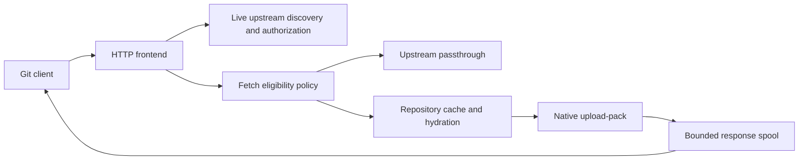

# Design

Git CDN is an HTTP reverse proxy with a local Git object cache. The upstream Git host remains authoritative for credentials, visible refs and writes. Native Git performs negotiation, object receipt and pack generation; Go controls routing, authorization, cache publication and resource limits.

## Request paths



Single-site mode uses `/owner/repository`; multi-site mode uses `/<site>/owner/repository`. The configured upstream is fixed, and `.git` is normalized before forwarding. The CDN has its own domain and credential scope. It is not a CONNECT tunnel or a byte-for-byte HTTP proxy: it filters headers, rewrites trusted redirects and generates local fetch responses.

Discovery and client ls-refs requests go upstream. Supported v2 fetches can use the cache; push, shallow/filter requests, unknown extensions, SHA-256 and v0/v1 use passthrough. See the README for the current support matrix.

## Authorization boundary

Every fetch selected for local execution performs a fresh upstream ls-refs query using that request's credentials. A previous discovery, another user's result or the presence of local objects does not authorize a read. Invalid/oversized responses and authentication failures cannot serve cached data.

Protocol v2 permits direct OID wants beyond advertised refs. Git upload-pack can serve retained objects that no longer appear in upstream refs, so its configuration switches are not sufficient authorization. The local path accepts current advertised tip/tag/peeled OIDs; other wants are forwarded for the upstream to decide. Haves must be ancestor commits of authorized roots. Relevant tags are checked before include-tag processing.

Cache identity includes the canonical upstream URL, repository path, object format and credential HMAC. Credentials are passed to native Git through request-scoped configuration in the environment, without storing them in remote URLs. Request-specific ref views keep storage refs and stale tags out of response semantics. An alternates view is not an independent ACL: shared Git object stores need an explicit trust boundary.

Native Git's [protocol v2 specification](https://git-scm.com/docs/gitprotocol-v2) and [namespace security discussion](https://git-scm.com/docs/gitnamespaces) are the behavioral references. Reproducible [protocol probes](protocol-probes.md) establish the relevant primitives.

## Object storage and hydration

```text
cache/
  .lock
  .scope-key
  repos/<repository-hash>/<credential-HMAC>/
    .access
    repo.git/
  tmp/
    hydrate-*/
    view-*/
    response-*
```

The cache is a bare object repository, not a complete branch mirror. `refs/cache/roots/<oid>` retain verified root histories. For a local fetch:

1. Acquire a lease for the repository/credential scope.
2. Traverse the wanted roots with `rev-list --objects --missing=error`; a present commit alone does not prove completeness.
3. If data is missing, initialize staging and fetch exact OIDs with the caller's identity.
4. Use existing roots and alternates for incremental negotiation only when their dependency graph is intact.
5. Validate staging, reserve capacity, publish objects and pin roots.
6. Build the current request's ref view and run upload-pack.

Fresh caches are published by renaming checked staging. Existing caches install pack data before indexes and refs. Failed staging is removed on the normal error path. Missing objects, authorization failures and transport errors remain distinct outcomes; ordinary failures do not blindly delete/reclone the whole cache.

The current model stores complete histories for requested roots. It does not import arbitrary external shallow/promisor repositories or resume incomplete packs. Filtered/shallow client requests go upstream. Server-side native lazy fetching is disabled. Adding promisor storage needs object authorization, completeness metadata, bounded fetches and safe interaction with maintenance.

Upstream branch deletion or force-push changes the current ref view immediately. Old roots remain pinned until the whole scope is evicted; root expiry and object-level GC are not implemented. Removing an old root does not reclaim history still reachable from another live root, and deleting a pack directly can break shared objects.

## Capacity and concurrency

Persistent repository scopes use LRU with capacity reservations and restartable access timestamps. Active and queued leases protect their objects. Oversized requests and fully pinned capacity use upstream fallback. Temporary files have separate operating constraints; the admission limit is not a filesystem quota. See [Cache policy](cache-policy.md).

The current per-scope gate is exclusive and covers validation, hydration and local pack generation. HTTP transfers can overlap after spool generation ends, but same-scope packing is serialized. A global limit controls all native Git processes, including metadata commands.

Capacity accounting and eviction currently perform filesystem work under the store mutex. Future improvements should separate read pins from write/maintenance locks, move expensive deletion out of the global critical section, and avoid rescanning unchanged scopes on every release.

## Response delivery and performance

Local upload-pack writes a bounded temporary response before the server commits headers. This preserves the ability to forward one complete upstream response after local generation failure. Generation and spool writes overlap, but client transfer starts only after success. Cold requests additionally complete upstream fetch/index/check/publication before local packing.

This design increases time to first byte and file I/O. It also generates packs on every object-cache HIT. A future pack-objects cache can combine identical producers and reuse completed output; a streaming mode can reduce latency but must define errors after response commitment, when complete fallback is no longer possible.

Measure request upload, authorization, lease queueing, dependency checks, hydration, publication, pack generation, spool I/O and client transfer separately. Correctness checks and one-off elapsed times are not throughput or latency baselines. The [testing guide](testing.md) describes workload selection and reproducibility.

## Deployment

A production data plane benefits from stable placement, enough local SSD space and controlled cache lifecycle. Each instance currently owns an independent cache; application cache coordination and cross-node routing are external concerns. The upstream remains the recoverable source of all objects.

SSH is planned. Terminating SSH at a separate CDN cannot reuse the client's upstream authentication signature. It needs platform delegation, a configured identity mapping or explicit agent forwarding. SSH v0/v1 also needs a stateful negotiation design; HTTP stateless processing alone is not sufficient.

## Code map

| Package | Responsibility |
| --- | --- |
| `internal/config` | YAML, site modes, defaults and validation |
| `internal/protocol` | pkt-line parsing, v2 classification and ref snapshots |
| `internal/nativegit` | Controlled Git execution and process cancellation |
| `internal/cache` | Leases, object receipt/publication, ref views and LRU |
| `internal/server` | Routing, upstream probes, local response generation and passthrough |
| `cmd/git-cdn` | Listener, TLS and lifecycle |
